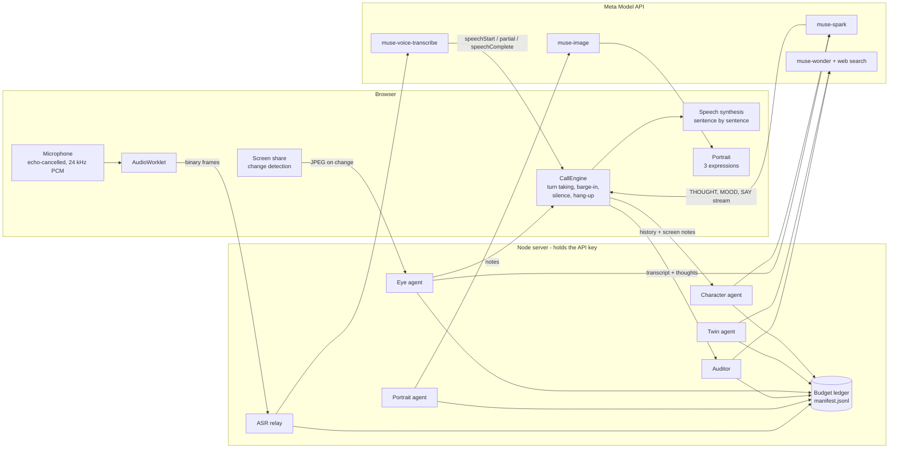

# Sparing Live

**Rehearse the conversation you are afraid of, against someone who talks back like a real person.**

Sparing Live is a real-time voice system built on Meta's Muse models, in English and in Polish. You call a counterpart (a skeptical buyer, a thesis examiner, your manager, an investor). It listens, thinks, interrupts you, reads your shared screen, changes its face with its mood, and can hang up. Afterwards a reviewer shows you exactly where you lost them, using what the character was privately thinking.

It is not a chatbot with a persona prompt. It is a pipeline of specialised agents with hidden state, a full-duplex voice loop, and measured guarantees (see [Evaluation](#evaluation)).

> Built for the Meta Global AI Developer Hackathon (26 Oct – 4 Nov 2026). Everything in this repository was written during the hackathon. An earlier Polish prototype on a local model existed before; this is a from-scratch rebuild on the Meta Model API, in English.

## What makes it different

| | |
|---|---|
| **Digital twin of a real company** | Type `basecamp.com`. Muse Wonder runs a live web-search research loop (searches, opens pages, cross-checks), and the person you call knows what the real company knows: its pricing problems, its launch, its vocabulary. Every search step is shown live. |
| **An opponent that can see** | Share a slide deck, code, or your portfolio. The eye agent reads the screen and the counterpart pounces on the weak slide: *"94% — compared to what?"* |
| **Mind reading** | Every reply carries a private thought and a mood that the user never hears. The post-call replay reveals them, so you see the exact sentence where "curious" turned into "losing him". |
| **A face that reacts** | Muse Image draws the counterpart once and edits the same person into three expressions. The face follows the character's mood during the call. |
| **Real interruptions** | Full-duplex voice. Talk over the character and it stops mid-sentence; the transcript shows where it was cut off. |
| **An opponent that learns** | The auditor tags what you keep getting wrong ("dodged price", "vague intro"); the next character aims at it. |
| **A clip you can post** | One click renders a captioned MP4 of the key moment (their face, their private thoughts, your score) in the browser, with post text ready to copy. |
| **English and Polish** | One switch changes everything: the interface, the character and its private thoughts, the company research, the review, speech recognition and the voice. Polish is written for Polish, with gender and "Pan/Pani" handled (see [Two languages](#two-languages)). |
| **Measured, not claimed** | Latency, repetition, stage-direction leaks and difficulty behaviour are measured against the live API by `npm run eval`. A budget guard with a persistent ledger caps spend. |

## Meta models used, and where

| Model | Role | Measured |
|---|---|---|
| `muse-spark-1.3` | Live counterpart (streamed, tagged format); the **eye** agent (vision) | first spoken word median 1.1 s; screen read in 2.7 s |
| `muse-wonder-1.0` | **Twin research** with live web search (Responses API); **post-call audit** (JSON schema) | twin about 30 s; audit about 13 s |
| `muse-voice-transcribe-1.0` | **Ears**: realtime WebSocket in `ENDPOINTING` mode, language bias per call (English or Polish) | final text 0.36 s after speech ends; a Polish test sentence came back word for word |
| `muse-image-1.0` | **Face**: one portrait plus two expression edits | three images in about 30 s, 3 cents |
| Muse Spark Open | The character can run on **open weights**: one tick on the start screen, same protocol, served by Baseten (or Fireworks, Modal, local Ollama); `docs/MANIFEST.md` records which calls ran where, and a failing host falls back to Spark | median first word 1.2 s, 0 failures in 24 scripted calls ([`docs/EVAL.open.md`](docs/EVAL.open.md)); 512 open-weights calls in the manifest |
| ElevenLabs `eleven_v4_turbo` | Optional **voice** of the character (not a Meta model): studio-quality speech in English and Polish, streamed sentence by sentence; the browser's voice is the fallback | about 100 ms model latency; see [Voice and cost](#voice-and-cost) |
| `sam-3.1` | Optional camera: finds the face in a frame, so the review can cite framing facts (left the frame, leaned back) at the right moment | face box in about 2.7 s |

Muse Spark Open always reasons, and Baseten's default depth (`xhigh`) is too slow to speak: measured over the same 24 calls, `xhigh` gave a median 3.4 s to the first word (p95 7.1 s), about 930 output tokens per turn and 3 empty replies when the reasoning used the whole budget, while `reasoning_effort: low` gives 1.2 s (p95 2.2 s), about 170 tokens and no failures. The Baseten preset therefore sends `low`. The host allows 100 requests a minute, which one call uses a small part of; if the host fails or limits a turn before the character has spoken, that turn is asked again from Meta's hosted Spark with the same prompt and the call says so.

Notes from measuring the API (they shaped the design): reasoning tokens count against `max_tokens`; `json_schema` output does not stream and returns keys alphabetically (so live turns use a tagged plain-text format and the character decides to hang up *after* it has spoken); web search exists only on the Responses API; the `-contributor` variant of Spark is 2-4x slower than the standard model.

## Open weights: where and why

One stage runs on Muse Spark Open, and it is the one that is load-bearing for the whole product: **the live counterpart** (`characterTurn` in `server/agents/persona.ts`). Every spoken turn of the call, including the private thought, the mood on the face and the decision to hang up, is produced by the open-weight model when the start-screen tick is on. Nothing else about the call changes: same prompts, same tagged stream, same barge-in loop.

Why this stage: it is the highest-volume, most latency-sensitive call (one per turn, the user waits for the first word), so it is where an open model you can host yourself matters most, and where the cost and speed can be measured against the hosted model on identical scripted calls ([`docs/EVAL.open.md`](docs/EVAL.open.md) against [`docs/EVAL.md`](docs/EVAL.md), same for Polish). The other stages stay on hosted Muse models, each the model made for its task: Wonder for web-search research (search exists only on Meta's Responses API) and the structured audit, Spark for reading the shared screen, Muse Image for portraits, SAM 3.1 for camera framing, Voice Transcribe for the ears. The hybrid is deliberate, not a fallback: if the open host fails before the character has spoken, that one turn is asked again from hosted Spark and the call says so, and `docs/MANIFEST.md` records which model answered each call.

## Architecture



**One live turn.** The relay streams microphone audio to Voice Transcribe. When the model reports `speechComplete`, the engine sends the history (and the latest screen notes) to the character agent. Spark streams a tagged reply (`THOUGHT / MOOD / SAY / HANGUP`); the server forwards only the text after `SAY:` as it arrives, the browser speaks it sentence by sentence, and the thought and mood are kept for the replay. If the user speaks over it, the engine cancels speech and generation and records the interrupted line.

**Why a tagged format.** In JSON mode the whole object arrives at once, and keys come back in alphabetical order, so `hangup` is decided before the reply exists. Tagged text streams, keeps the order we ask for, and lets the first sentence be spoken while the model is still writing.

**Cost control.** Every call is recorded (model, tokens, cost, latency) in `data/manifest.jsonl`. The ledger enforces a daily and a per-session budget, survives restarts, and never cuts a call already in flight. Meta's own spend limit is only a notification, so this is what protects the card.

## Run it

Requirements: Node 22+, a Meta Model API key from <https://dev.meta.ai>. Use Microsoft Edge or Chrome (speech synthesis and screen share).

```bash
npm install
cp .env.example .env      # then put your key in MODEL_API_KEY
npm run dev               # http://localhost:5173
```

Wear headphones, so the character does not hear itself.

| Command | What it does |
|---|---|
| `npm run check:meta` | Probes the API: chat, streaming, JSON schema, Wonder |
| `npm run try:turn` | Plays a short scripted call and prints latency per turn (`-- --lang pl` for Polish) |
| `npm run try:twin -- basecamp.com` | Researches a company and prints the twin |
| `npm run try:audit` | Audits a scripted call (`-- --lang pl` for Polish) |
| `npm run try:portrait` | Draws the three portraits |
| `npm run check:voice` | Lists the ElevenLabs voices and saves a sample line per default voice to `data/voice-samples/` |
| `npm run check:open` | Probes the open-weights host (see `.env.example` for Baseten, Fireworks, Modal, Ollama) |
| `npm run manifest` | Rebuilds [`docs/MANIFEST.md`](docs/MANIFEST.md) from the budget ledger: models, tokens, cost, latency, open-weights share |
| `npm test` | Unit tests: stream parser, text helpers, budget ledger, metrics, both languages |
| `npm run eval` | Behaviour evaluation against the live model, writes `docs/EVAL.md` (`-- --lang pl` writes `docs/EVAL.pl.md`) |

## Two languages

The product runs in English and Polish. The switch is on the start screen (it starts in the browser's language) and covers the interface, the character and its private thoughts, the company research, the post-call review, speech recognition, the voice and the clip.

Polish is written for Polish rather than translated line by line: złoty instead of dollars, a defence in front of a *komisja*, a manager who may be addressed as *Pan/Pani* or by *ty*. Three things make a Polish conversation believable that an English one does not need:

- **Gender.** Polish verbs and adjectives carry gender (*zrobiłem* / *zrobiłam*). Every character has one, and its sheet, difficulty rules and daily circumstances are written with `{m|f}` markers that are resolved for it. The start screen also asks for the user's gender and whether you address each other formally or by *ty*, so the character says *Pani* and *sprawdziłaś* to a woman and the auditor writes its "say this instead" lines in the user's gender. The company research is told the gender of the character too, so the profile it writes agrees with the person you call. When a scripted caller got this wrong in testing, the character noticed: *"Powiedziała do mnie Pan"*.
- **Letters.** A `[a-z]` regex cuts Polish words in half at *ł* or *ż*, so echo detection, filler counting and stop words work on Unicode letters. Polish fillers (*yyy, no więc, w sumie, jakby*) are counted as whole words only.
- **Voice.** Edge's Natural voices (Zofia, Marek) or Windows' Paulina; if the browser has no voice of the right gender, the pitch is shifted instead. The start screen warns when no Polish voice exists.

| Piece | Measured in Polish |
|---|---|
| Speech recognition | A synthesised Polish sentence with *Dzień, Dzwonię, państwa, ładuje* came back word for word through our relay with `languageBias: Polish` (with the English bias only *Pan* lost its capital) |
| Character | `npm run eval -- --lang pl`: 0 repeated turns in 306 pairs, 0 leaked stage directions, 0 failed turns; median first word 1.6 s (English 1.1 s: Polish takes more tokens, so the private thought is capped at 12 words), p95 2.8 s. See [`docs/EVAL.pl.md`](docs/EVAL.pl.md) |
| Review | The Polish audit quotes what was said, ties it to the character's thoughts and writes in the user's gender; the delivery numbers (filler words, interruptions) are measured, not guessed |

Difficulty still changes behaviour in Polish, but with three seeds per cell the middle levels are noisy: *Realistyczny* hung up on the weak caller 2 times in 3 in one run and 0 in the next, *Twardy* and *Brutalny* 3 in 3 both times. The English evaluation has the same sample size.

## Voice and cost

Meta has no speech-synthesis model (the Model API lists chat, Wonder, Image, SAM and Voice Transcribe only), so the character's *voice* comes from one of two places:

- **The browser's own voices** (no key, no cost). Outside Edge on Windows these are basic system voices and sound robotic; Edge has much better Natural voices. The start screen lists the voices that fit the character's gender, lets you hear them, and warns when only basic ones exist.
- **ElevenLabs** (optional, set `ELEVENLABS_API_KEY`). The server streams each sentence of the character's reply to ElevenLabs the moment it is written and the browser plays the 24 kHz PCM back to back on the audio clock, so there are no gaps. The next sentence is requested with the previous one as context, so the intonation continues. If the user cuts in, the line is recorded up to the word that had actually played. If ElevenLabs fails mid-call (quota, key, network), the browser voice takes over and the call says so.

What it costs, from the [ElevenLabs API price list](https://elevenlabs.io/pricing/api) checked 2026-10-28: `eleven_v4_turbo` (the model for real time) and Flash are **$0.04 per 1,000 characters**; `eleven_v4` is $0.08. A reply is about 130 to 180 characters and a five-minute call has 10 to 14 replies, so a call is **about 2,000 characters, about 8 cents**. Plans include characters: Starter $6 a month (first month $1) has 150,000 on Turbo, Creator $22 has 550,000, Pro $99 has 2.5 million.

| Use | Calls | Characters | Cost at $0.04 per 1K |
|---|---|---|---|
| Development and testing | 50 | 100,000 | $4 |
| Recording the demo, many takes | 20 | 40,000 | $1.60 |
| Judges and visitors for two weeks | 300 | 600,000 | $24 |
| If an X post takes off | 1,500 | 3,000,000 | $120 |

Three guards keep it bounded: 8,000 characters per session, 20,000 per visitor per hour and 150,000 per day (all in `.env`), counted in the same ledger as the Meta calls. Past a cap the call continues with the browser voice, it does not stop. `docs/MANIFEST.md` lists the characters actually spoken and the estimated cost. Only the character's lines go to ElevenLabs, never the user's audio.

## Evaluation

`npm run eval` plays 24 scripted calls (weak and strong caller, four difficulty levels, three seeds) and writes [`docs/EVAL.md`](docs/EVAL.md). Latest run: 0 repeated turns in 287 pairs, 0 stage directions leaked into speech, 0 failed turns, median time to first spoken word 1.1 s. Difficulty changes behaviour: the friendly character never hangs up on a weak caller, the others do, and no strong caller is ever hung up on. The same evaluation in Polish is in [`docs/EVAL.pl.md`](docs/EVAL.pl.md), and on open weights in [`docs/EVAL.open.md`](docs/EVAL.open.md) and [`docs/EVAL.open.pl.md`](docs/EVAL.open.pl.md).

## Privacy

Rehearsals can contain sensitive material. Audio is relayed to Muse Voice Transcribe and never stored by this app. If an ElevenLabs key is set, the character's own lines (never the user's audio) are sent to ElevenLabs to be spoken. The hackathon credits only cover the standard Contributor variants of Meta's models: content sent to them (your voice for transcription, the text of the call, and, if you turn them on, screenshots of the screen you share and frames from the camera) may be used to train future Meta models, the opt-out variants are not covered by these credits, and zero data retention cannot be enabled for them. The app says so before the first call, and screen sharing and the camera are both off until you start them. With the open-weights tick on, the text of the live turns goes to the open-weights host (Baseten in the default setup) instead of Meta's hosted Spark; that host's own terms apply and are not checked here. Weak-spot memory lives only in your browser (`localStorage`) and can be erased with one click. A researched company (public web findings only) is kept on the server for 24 hours so the same company and pitch is not researched twice; it contains no audio or transcripts.

## Layout

```
server/agents/   character, twin, eye, auditor, portrait (each with its Polish prompt)
server/meta/     API clients, pricing table, budget ledger
server/asr.ts    realtime transcription relay
shared/          types, scenarios, variation, audit schema, speech cleaning, language helpers (*.pl.ts hold the Polish content)
src/engine/      CallEngine: turn taking, barge-in, silence, hang-up
src/screens/     setup, twin research, call, review
src/i18n/        interface text: English defines the keys, Polish is typed with them, so a missing string does not compile
tests/           unit tests    scripts/  probes and evaluation
```

## Status

Working: English and Polish end to end (character, research, review, clip, speech recognition), voice loop, four scenarios with four difficulty levels, digital twin, screen understanding, portraits, audit with replay, weak-spot memory, budget guard, tests and evaluation. Polish verified through the browser (typed input), the live API and the speech relay; the Polish voices were not heard here. Built, awaiting live verification with a real microphone and camera: Voice Transcribe on a live mic, screen share, camera framing with SAM 3.1, and the open-weights switch is verified on Baseten (evaluation, manifest and a live call in the browser) but not on Fireworks, Modal or Ollama. Built and verified: shareable clip (MP4 rendered in the browser), manifest generation, twin cache (a repeated company returns in 3 s instead of 28 s and costs nothing), deployment files (Dockerfile, static serving, per-visitor rate limits). The ElevenLabs voice is built and tested against a stand-in service (streaming playback without gaps, cut-in estimation, fallback to the browser voice, limits, optional fields a model refuses); it has not been heard with a real key yet. Not yet deployed.
