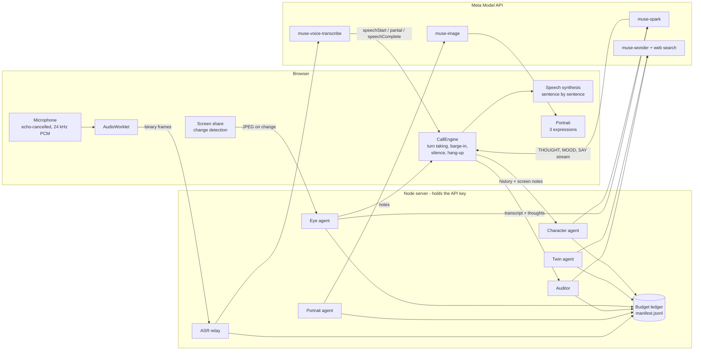

# Sparing Live

**Rehearse the conversation you are afraid of, against someone who talks back like a real person.**

Sparing Live is a real-time voice system built on Meta's Muse models. You call a counterpart (a skeptical buyer, a thesis examiner, your manager, an investor). It listens, thinks, interrupts you, reads your shared screen, changes its face with its mood, and can hang up. Afterwards a reviewer shows you exactly where you lost them, using what the character was privately thinking.

It is not a chatbot with a persona prompt. It is a pipeline of specialised agents with hidden state, a full-duplex voice loop, and measured guarantees (see [Evaluation](#evaluation)).

> Built for the Meta Global AI Developer Hackathon (26 Oct – 4 Nov 2026). Everything in this repository was written during the hackathon. An earlier Polish prototype on a local model existed before; this is a from-scratch rebuild on the Meta Model API, in English.

## What makes it different

| | |
|---|---|
| **Digital twin of a real company** | Type `basecamp.com`. Muse Wonder runs a live web-search research loop (searches, opens pages, cross-checks), and the person you call knows what the real company knows: its pricing problems, its launch, its vocabulary. Every search step is shown live. |
| **An opponent that can see** | Share a slide deck, code, or your portfolio. The eye agent reads the screen and the counterpart pounces on the weak slide: *"94% — compared to what?"* |
| **Mind reading** | Every reply carries a private thought and a mood that the user never hears. The post-call replay reveals them, so you see the exact sentence where "curious" turned into "losing him". |
| **A face that reacts** | Muse Image draws the counterpart once and edits the same person into three expressions. The face follows the character's mood during the call. |
| **Real interruptions** | Full-duplex voice. Talk over the character and it stops mid-sentence; the transcript shows where it was cut off. |
| **An opponent that learns** | The auditor tags what you keep getting wrong ("dodged price", "vague intro"); the next character aims at it. |
| **A clip you can post** | One click renders a captioned MP4 of the key moment (their face, their private thoughts, your score) in the browser, with post text ready to copy. |
| **Measured, not claimed** | Latency, repetition, stage-direction leaks and difficulty behaviour are measured against the live API by `npm run eval`. A budget guard with a persistent ledger caps spend. |

## Meta models used, and where

| Model | Role | Measured |
|---|---|---|
| `muse-spark-1.3` | Live counterpart (streamed, tagged format); the **eye** agent (vision) | first spoken word median 1.1 s; screen read in 2.7 s |
| `muse-wonder-1.0` | **Twin research** with live web search (Responses API); **post-call audit** (JSON schema) | twin about 30 s; audit about 13 s |
| `muse-voice-transcribe-1.0` | **Ears**: realtime WebSocket in `ENDPOINTING` mode | final text 0.36 s after speech ends |
| `muse-image-1.0` | **Face**: one portrait plus two expression edits | three images in about 30 s, 3 cents |
| Muse Spark Open | The character can run on open weights: one tick on the start screen, same protocol. Host is configurable (Baseten, Fireworks, Modal or local Ollama); `docs/MANIFEST.md` records which calls ran where | switch and manifest built; no open-weights call recorded yet |
| `sam-3.1` | Optional camera: finds the face in a frame, so the review can cite framing facts (left the frame, leaned back) at the right moment | face box in about 2.7 s |

Notes from measuring the API (they shaped the design): reasoning tokens count against `max_tokens`; `json_schema` output does not stream and returns keys alphabetically (so live turns use a tagged plain-text format and the character decides to hang up *after* it has spoken); web search exists only on the Responses API; the `-contributor` variant of Spark is 2-4x slower than the standard model.

## Architecture



**One live turn.** The relay streams microphone audio to Voice Transcribe. When the model reports `speechComplete`, the engine sends the history (and the latest screen notes) to the character agent. Spark streams a tagged reply (`THOUGHT / MOOD / SAY / HANGUP`); the server forwards only the text after `SAY:` as it arrives, the browser speaks it sentence by sentence, and the thought and mood are kept for the replay. If the user speaks over it, the engine cancels speech and generation and records the interrupted line.

**Why a tagged format.** In JSON mode the whole object arrives at once, and keys come back in alphabetical order, so `hangup` is decided before the reply exists. Tagged text streams, keeps the order we ask for, and lets the first sentence be spoken while the model is still writing.

**Cost control.** Every call is recorded (model, tokens, cost, latency) in `data/manifest.jsonl`. The ledger enforces a daily and a per-session budget, survives restarts, and never cuts a call already in flight. Meta's own spend limit is only a notification, so this is what protects the card.

## Run it

Requirements: Node 22+, a Meta Model API key from <https://dev.meta.ai>. Use Microsoft Edge or Chrome (speech synthesis and screen share).

```bash
npm install
cp .env.example .env      # then put your key in MODEL_API_KEY
npm run dev               # http://localhost:5173
```

Wear headphones, so the character does not hear itself.

| Command | What it does |
|---|---|
| `npm run check:meta` | Probes the API: chat, streaming, JSON schema, Wonder |
| `npm run try:turn` | Plays a short scripted call and prints latency per turn |
| `npm run try:twin -- basecamp.com` | Researches a company and prints the twin |
| `npm run try:audit` | Audits a scripted call |
| `npm run try:portrait` | Draws the three portraits |
| `npm run check:open` | Probes the open-weights host (see `.env.example` for Baseten, Fireworks, Modal, Ollama) |
| `npm run manifest` | Rebuilds [`docs/MANIFEST.md`](docs/MANIFEST.md) from the budget ledger: models, tokens, cost, latency, open-weights share |
| `npm test` | Unit tests: stream parser, text helpers, budget ledger, metrics |
| `npm run eval` | Behaviour evaluation against the live model, writes `docs/EVAL.md` |

## Evaluation

`npm run eval` plays 24 scripted calls (weak and strong caller, four difficulty levels, three seeds) and writes [`docs/EVAL.md`](docs/EVAL.md). Latest run: 0 repeated turns in 287 pairs, 0 stage directions leaked into speech, 0 failed turns, median time to first spoken word 1.1 s. Difficulty changes behaviour: the friendly character never hangs up on a weak caller, the others do, and no strong caller is ever hung up on.

## Privacy

Rehearsals can contain sensitive material. Audio is relayed to Muse Voice Transcribe and never stored by this app. While free Meta credits are in use, Meta may use content for product improvement; the app says so before the first call. Weak-spot memory lives only in your browser (`localStorage`) and can be erased with one click. A researched company (public web findings only) is kept on the server for 24 hours so the same company and pitch is not researched twice; it contains no audio or transcripts.

## Layout

```
server/agents/   character, twin, eye, auditor, portrait
server/meta/     API clients, pricing table, budget ledger
server/asr.ts    realtime transcription relay
shared/          types, scenarios, variation, audit schema, speech cleaning
src/engine/      CallEngine: turn taking, barge-in, silence, hang-up
src/screens/     setup, twin research, call, review
tests/           unit tests    scripts/  probes and evaluation
```

## Status

Working: voice loop, four scenarios with four difficulty levels, digital twin, screen understanding, portraits, audit with replay, weak-spot memory, budget guard, tests and evaluation. Built, awaiting live verification with a real microphone and camera: Voice Transcribe on a live mic, screen share, camera framing with SAM 3.1, and the open-weights switch (built for Baseten, Fireworks, Modal and Ollama, tested only in unit tests because no host key has been available yet). Built and verified: shareable clip (MP4 rendered in the browser), manifest generation, twin cache (a repeated company returns in 3 s instead of 28 s and costs nothing), deployment files (Dockerfile, static serving, per-visitor rate limits). Not yet deployed.
